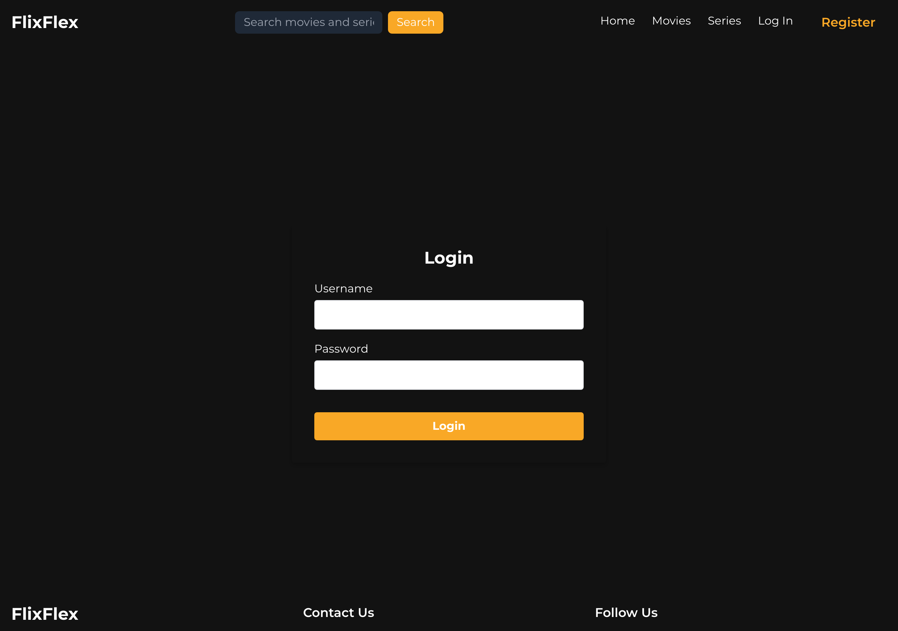

# FlixFlex (frontend)

A movie and series browser built with React and Vite: trending titles, paginated movie and series catalogues, search across both, detail pages, and a personal favourites list for signed-in users. Catalogue data comes from [The Movie Database](https://www.themoviedb.org/) API; accounts and favourites come from the companion [FlixFlex backend](https://github.com/Nada-Hanad/flix-flex-backend).



*Captured in November 2026 from a production build. The catalogue pages need a TMDB API key, so only the account pages are shown here.*

## Features

- Home page with a hero section and carousels of popular movies and series.
- Movies and series grids paged with Swiper, and detail pages with a like button.
- Search across movies and series from the navigation bar.
- Registration and login with a JWT kept in a cookie; favourites are added and removed through the backend and listed on their own page.
- Toast notifications for success and errors, and a 404 page.

## Stack

React 18, Vite, React Router, Material UI, Swiper, Axios, js-cookie and react-toastify.

## Running it

```bash
npm install
# create .env with the four variables below
npm run dev
```

| Variable | Purpose |
|---|---|
| `VITE_API_BASE_URL` | TMDB API base URL |
| `VITE_API_KEY` | TMDB API key |
| `VITE_POSTER_BASE_URL` | TMDB image base URL |
| `VITE_AUTH_API_BASE_URL` | URL of the FlixFlex backend |
